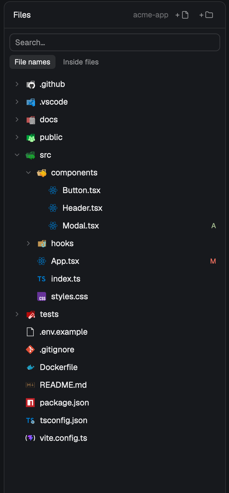

# Files Plus for Herdr

A [Herdr](https://herdr.dev) mod: a Files panel that edits. Right-click to copy, cut, paste,
rename, duplicate and trash; drag to move; filter by name and search inside files;
[vscode-icons](https://github.com/vscode-icons/vscode-icons) for every file and folder.



## Features

- **Files open in a tab**: click a file and it opens whole in a new tab, in an editor with
  syntax colors. ⌘S saves; the tab shows `●` while there are unsaved changes. Clicking it
  again goes back to its tab. Space still gives a quick look inside the panel.
- **Right-click menu** on files, folders and the empty area: New file, New folder, Rename,
  Duplicate, Cut, Copy, Paste, Copy path, Reveal in Finder, Move to Trash.
- **Drag and drop** a row onto a folder to move it; hold **⌥** to copy. Closed folders open
  when you hover them. Drop files from Finder to copy them in.
- **Search**: *File names* filters the whole tree, closed folders included (it respects
  `.gitignore`); *Inside files* finds text with `rg`, `git grep` or `grep` and opens the file
  in its tab at the matching line.
- **Icons and colors** from vscode-icons: about 1,900 file names, 1,000 extensions and 520
  folder names, with opened-folder icons.
- **Safe by default**: copies never overwrite (`name copy.ext`, `name copy 2.ext`), moves and
  renames refuse existing names, delete asks first and uses the Trash on your Mac.
- **Remote machines too**: everything runs on the space's machine, so it works in ssh
  machines and sandboxes (delete there is permanent, and the dialog says so).

### Keys

Click a file to open it in a tab (⌘S saves there). In the panel: ↑/↓ select · ←/→ close/open · Space preview · Enter rename · ⌘C ⌘X ⌘V
copy/cut/paste · ⌘D duplicate · ⌘⌫ delete · ⌘F search names · ⇧⌘F search inside files ·
Esc clear.

## Install

Ask the agent in your Herdr window:

> Add the mod herdr.dev/mods/samucars/herdr-files-plus and use it as my Files panel.

Or by hand:

1. Copy `mods/files-plus/` to `~/.config/herdr-app/mods/files-plus/`.
2. Herdr's shipped layouts are updated by the app, so clone yours:
   `herdr-app do layout.clone '{"name":"main","as":"my-layout"}'`.
3. In `~/.config/herdr-app/layouts/my-layout.json`, find the panel block
   `{ "id": "files", "type": "block", "content": { "mod": "files" } }` and change
   `"mod": "files"` to `"mod": "files-plus"`.
4. Run `herdr-app check ~/.config/herdr-app/mods/files-plus`. The Files button now opens
   Files Plus. Switch back to `main` any time to get the original.

**Heads-up:** this mod runs programs (`sh`, `git`, `cp`, `mv`, `rm`, `trash`, `rg`/`grep`)
and changes files in the folder you are looking at. It doesn't use the network.

## Limits

No multi-select, no copy or move between machines, files on other machines open read-only,
files over 1 MB don't open, and changes and
search need `sh` (no Windows). The tree shows up to 500 entries per folder; searches are
capped (300 names, 2,000 matching lines). See [RECIPE.md](RECIPE.md) for the full behavior.

## Icons

`mods/files-plus/icons/` and `icons.js` are generated from the vscode-icons extension
(13.0.0) by `scripts/build_icons.py`. To update them, unpack a newer `.vsix` from
[Open VSX](https://open-vsx.org/extension/vscode-icons-team/vscode-icons) and run:

```sh
python3 scripts/build_icons.py <unpacked>/extension mods/files-plus
```

## Credits and license

Started from Herdr's built-in `files` mod (the folder listing and preview). Icons:
vscode-icons, © Roberto Huertas and contributors, MIT (`mods/files-plus/icons/LICENSE.txt`).
Everything else: MIT, see [LICENSE](LICENSE).
