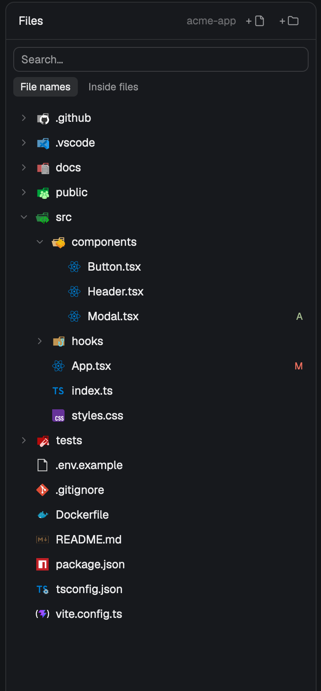

# Files Plus

A Files panel that can change files, not only show them. It lists the focused pane's folder
as a tree with a full-color vscode-icons icon for every file and folder and Git marks on the
right. Right-click any row for New file, New folder, Rename, Duplicate, Cut, Copy, Paste,
Copy path, Reveal in Finder and Move to Trash; drag a row onto a folder to move it (⌥ copies);
drop files from Finder to copy them in. A search box on top filters the whole tree by file
name or searches inside files. It takes the place of Herdr's own `files` mod in a layout's
panel, and works on remote machines (sandboxes, ssh) as well as this one.

## What you see

One column on the `background` color, radius 10, a 1px `border`, base type 13px. Top to bottom:

- **Header**, 42px tall, 14px side padding, a 1px `border` line below. "Files" in semibold
  `foreground`; then, right-aligned and truncated, the root folder's name at 12px `dim`
  (the open file's path while a preview shows, with a `←` back button before "Files").
  On the right two 24px buttons, `muted`, `hover` background: `+` and the file outline
  (New file), `+` and the folder outline (New folder). They act on the selected folder, the
  selected file's folder, or the root.
- **Search**, 8px side padding, 8px above, 4px below:
  - An input 28px tall, radius 7, 1px border (`accent` while focused, else `input`),
    placeholder `Search…`, 12.5px. While it has text, a `×` (18px, `dim`) clears it.
  - Below, 6px gap: two pills 22px tall, 8px side padding, radius 5, 11.5px: "File names"
    and "Inside files". The chosen one is `foreground` on `selected`; the other is `muted`.
    Right-aligned beside them, 11px `dim`: `Searching…`, `12 matches`, `No file names match`,
    `34 results in 9 files`, `No files contain this`, or the error.
- **Tree** (no search text), scrolling, 6px padding. Rows 28px tall, radius 7, 7px gaps,
  left padding 8px + 18px per level:
  - a 12px chevron (`dim`, right or down) on folders, a 12px blank on files;
  - the vscode-icons icon at 16px, full color; folders switch to their opened icon;
  - the name, truncated;
  - a Git mark at 11px: `A` (added or untracked) in `ansi2`, `M` in `blocked`, `D` and
    `U` in `ansi1`.
  - The selected row is on `selected`; others get `hover` under the pointer. A cut item and
    the row being dragged are at 50% opacity. While dragging, the folder under the pointer
    (when the drop is allowed) is on `selected` with a 1px `accent` border.
  - Below the rows, a 56px empty area that takes drops for the root folder; while it is the
    target the tree gets a 1px `accent` border.
  - `Loading files…`, `No files` or `No folder` (12px `dim`) when there are no rows;
    `File list limited to 500 entries per folder and 5,000 total` at 11px when capped.
- **Results** (search text), same rows without indentation:
  - File names: icon, the name (at most 200px), then its folder path at 11.5px `dim`.
  - Inside files: one row per file with the count of hits at 11px on the right; under it one
    24px row per hit, indented 29px: the line number right-aligned in 34px (11px `dim`) and
    the line, trimmed and cut to about 160 characters around the match, at 12px `muted`.
  - `Showing the first 300 matches` / `Showing the first 2000 lines` when capped.
- **Preview** (Space on a selected file): a read-only code editor with line numbers, the
  person's font at 12px and syntax colors from the theme (keyword `ansi5`, string `ansi2`,
  comment `dim`, function `ansi4`, type `ansi3`, number `ansi1`, constant `ansi6`).
  `Binary file · no text preview` for binary files; text past 400,000 characters is cut.
- **File tab** (click a file): a new tab named after the file, `● name` while there are
  unsaved changes. A 30px bar with a 1px `border` line below, 12px side padding, 12px type:
  the file's icon, its full path in `muted` (`machine:path` elsewhere), and on the right
  `Saved` / `Saving…` in `dim`, `Modified · ⌘S to save` in `blocked`, or `Read-only on
  <machine>`. On a save conflict: `Changed on disk` in `ansi1` with `Reload` and `Overwrite`
  links in `accent`. Then the find box: an input 200px wide, 22px tall, radius 6, 1px border
  (`accent` while focused, else `input`), placeholder `Find in file…`, 12px; a 62px count at
  11px (`3/12` in `dim`, `No results` in `ansi1`); ↑ and ↓ buttons, 18px, `muted`, `hover`
  background. Below, the whole file in an editable code editor at 13px with the same
  syntax colors as the preview. While the find box has text, the editor gives way to the
  find view: the file's lines, read-only, in the person's font at 13px, 20px rows with the
  line number in a 52px column (`muted` on lines with a match, else `dim`); each match on
  `ansi3` at 33% opacity, the current one on solid `ansi3` with `background` text, its row
  on `hover`. Lines past 2,000 characters are cut; tabs show as 4 spaces.
- **Drag label**, while dragging: a 26px chip at the pointer (14px right, 8px down), radius
  7, `popover` with `shadow_md` and a 1px border (`accent` when the drop is allowed, else
  `border`): the item's icon, its name (at most 160px), then `→ <folder>`, `copy to <folder>`
  with ⌥, or `can't drop here` in `dim`.
- **Context menu**, a popup 210px wide at the pointer, 5px padding, 12.5px: rows 26px tall,
  radius 6, a key hint at 11px `dim` on the right, 1px `border` separators. Disabled items
  (Paste with nothing to paste) are `dim`; the delete item is `ansi1`.
- **Dialogs**, 420px wide, centered, 18px padding on `popover`:
  - Rename / New file / New folder: the title at 15px semibold with `Esc` at 11px `dim` on
    the right, `in <folder>` at 11.5px `dim`, an input 36px tall, radius 9 (border `accent`,
    `ansi1` on error), the error under it in `ansi1`, then Cancel (`raised`) and
    Rename/Create (`solid`), 32px tall, radius 8. Rename preselects the name without its
    extension.
  - Delete, 170px tall: `Move “name” to Trash?` with "You can put it back from the Trash.",
    or on another machine `Delete “name”?` with "This deletes it permanently[, with
    everything inside]. It can't be undone."; Cancel and a red (`ansi1`) Move to
    Trash / Delete button.

## How it behaves

- **Where it looks:** the focused pane's live folder on its machine (a terminal block's
  machine when one is focused), else the space's folder. It follows focus; each folder keeps
  its own open folders and preview. Reloads on a folder watch (this machine), every 10 s,
  and right after any change it makes. Folders that vanish (renamed, moved, deleted) close.
- **Clicks:** a click selects a row and opens or closes a folder, or opens a file in its own
  tab. Space previews the selected file inside the panel; `←` or Esc goes back. Right-click a row for its menu; right-click the
  empty area for the root's (New file, New folder, Paste, Copy path, Reveal in Finder).
- **File tabs:** `tab.new {name, mod: "files-plus", props: {file, on, line}}`. The file
  (up to 1 MB, readTextFile's limit) is editable on this computer and read-only elsewhere.
  ⌘S saves with `writeTextFile` against the text it read, so a change made on disk meanwhile
  isn't overwritten: the bar offers Reload or Overwrite. With no unsaved edits, changes on
  disk are reloaded (folder watch). ⌘F focuses the find box (with the editor's selection
  in it when it's one line) and selects its text; typing selects the first match at or after
  the cursor (literal, case-insensitive, up to 10,000 matches, recounted as the text
  changes) and scrolls the find view to it. Enter or ⌘G selects the next match, ⇧Enter or
  ⇧⌘G the previous, wrapping. Esc, or a click on a line (its first match, else its start),
  empties the find box and returns to the editor with that spot selected. The find view
  exists because the editor (`EditorState`) has no way to mark text; it's a
  `v_virtual_list` with a `VirtualListScrollHandle`. Clicking a file that already has a tab selects that tab
  (and its space); from a text search it also selects the line. Which tab holds which file is
  kept in `files-plus.tabs` ("machine:path" → tab id); `props()` doesn't name the pane, so a
  new file tab claims the one `files-plus` tab no other file has.
- **Menu items:** Open (files, in a tab), New file…, New folder… (folders and root), Rename…,
  Duplicate, Cut, Copy, Paste (into the folder, or the file's folder; "Paste N items" for
  more than one), Copy path and Reveal in Finder (macOS; Reveal only on this machine), Move to
  Trash (this Mac) or Delete… (elsewhere). ↑/↓ and Enter work in the menu.
- **Keys** after clicking a row: ↑/↓ select, ←/→ close/open a folder (← on a file goes to its
  folder), Space previews, Enter renames, ⌘C copy, ⌘X cut, ⌘V paste, ⌘D duplicate, ⌘⌫ or
  Delete deletes (asks first), Esc clears the selection. ⌘F focuses the search on File names,
  ⇧⌘F on Inside files; in the search box Esc clears it and ↓ moves into the results.
- **Name clashes:** Copy, Paste and Duplicate never overwrite: they name the copy
  `name copy.ext`, `name copy 2.ext`, …. Move, Rename and New refuse an existing name with
  `"name" already exists`. Renaming only the letter case works.
- **Clipboard:** Copy/Cut keep the absolute paths in shared state (`files-plus.clipboard`,
  with the machine). Pasting on another machine is refused. A paste after Cut empties it.
- **Delete:** on this Mac the item goes to the Trash with `/usr/bin/trash`; if that program
  is missing the delete fails instead of falling back. On any other machine it is `rm -rf`.
- **Drag and drop:** press a row and move 5px to start. Over a folder the target is that
  folder, over a file its folder, below the list the root. A closed folder opens after 0.7 s
  under the pointer. Release to move; hold ⌥ to copy. Not allowed: a folder into itself or
  its children, or a move into the folder it is already in. Esc or leaving the panel cancels.
  After a move the item is shown selected in its new place. Dragging works in the tree, not
  in search results. Files dropped from Finder are copied in (this machine only).
- **File names search:** 250 ms after typing stops. Lists every file under the root (`git
  ls-files -co --exclude-standard` minus deleted files in a repo, else `find` without `.git`
  and `node_modules`; at most 20,000), kept 15 s or until a change. Matches are
  case-insensitive substrings of the path; folders match too (from the files' paths). Order:
  name starts with it, name contains it, path contains it; then shorter paths. Clicking a file
  opens its tab; clicking a folder clears the search and reveals it in the tree.
- **Inside files search:** literal, case-insensitive. `rg` when installed, else `git grep
  --untracked --exclude-standard` in a repo, else `grep -rnI` without `.git` and
  `node_modules`. At most 50 hits per file and 2,000 in all. Clicking a hit opens the file's tab
  with that line selected.
- Errors from changes show as a notification (`notify`, level error) titled "Files".

## Built from

- `mods/files-plus/main.js`: one `View`, default export, that is four things by `props()`:
  the panel (no props), a file tab (`{ file, on, line }`), the menu (`{ menu: true, ctx }`, a popup) and the dialogs
  (`{ dialog: "rename" | "newFile" | "newFolder" | "delete", ctx, value }`). `ctx` is
  `{ key, root, on, rel, dir }`: the panel's location key, root folder, machine, the path
  relative to root ("" = root) and whether it is a folder. `mod.json`: `{ "place": "none" }`.
- `mods/files-plus/ops.js`: every change runs `sh -c` on the space's machine (`exec` with
  `on`): `cp -Rp`, `mv`, `: >` (new file), `mkdir`, `trash` / `rm -rf`. Each script ends with
  `printf '__ok__'` and success is that marker in stdout (errors are sent to stdout too),
  because some remote transports drop stderr and exit codes. Free names (`name copy 2.ext`)
  are found in the same shell script.
- `mods/files-plus/icons/` and `icons.js`: 1,310 SVGs and a name map generated from
  vscode-icons 13.0.0 (MIT) by `scripts/build_icons.py`, which merges the extension's VS Code
  theme (`fileNames`, `fileExtensions`, `folderNames`, `folderNamesExpanded`) with its Zed
  theme (`file_stems`, `file_suffixes`, which also cover extensions VS Code maps by language,
  like `ts` and `py`); `css`, `scss` and `less` use their own icons. Lookup: exact lower-case
  name, then each extension from the longest (`d.ts` before `ts`), then the default.
  `chevron-*.svg`, `file.svg`, `folder.svg`: the outlines from Herdr's `files` mod.
- `herdr`: `spaces`, `panes`, `focused`, `exec`, `readTextFile`, `watchFolder`, `theme`,
  `settings`, `window`, `props`, `shared`/`setShared` (`files-plus.clipboard`,
  `files-plus.rev` to reload, `files-plus.reveal` to show a path), `openOverlay`,
  `closeOverlay`, `notify`. `gpui-kit`: `View`, `div`, `svg`, `image`; `gpui-base`:
  `v_flex`, `h_flex`, `Editor`, `EditorState`, `InputState`, `Input`. `run` for `tab.new`,
  `tab.select`, `space.select`, `tab.rename`; `writeTextFile` to save.
- Programs: `sh`, `git`, `find`, `sed`, `head`, `sort`, `uniq`, `cp`, `mv`, `mkdir`, `rm`,
  `trash`, `rg`/`grep`, and on macOS `open -R` and `pbcopy`. The listing and the Windows
  PowerShell fallback come from Herdr's `files` mod; changes and search need `sh`.
- Wiring: a layout's panel stack block `{ "id": "files", "type": "block", "content":
  { "mod": "files-plus" } }` in place of `"mod": "files"`.

## Watch out

- Drag and drop is built from `on_mouse_down`/`on_mouse_move`/`on_mouse_up`: `drag_paths`
  makes a native drag that only terminals accept, and `on_drop` only receives files from
  outside the app. A release outside any row is ended on the next tick (`cx.timer.after(0)`)
  so row handlers get it first; leaving the panel cancels, since there is no mouse-up outside.
  A click right after a drop (400 ms) is ignored so the drop doesn't also toggle the row.
- The panel and the overlays are copies of one mod with separate instances: they talk only
  through `shared` keys. The panel reacts in `render` by comparing a counter (`rev`, `n`).
- The search box must not lose keys to the panel: while it is focused only Esc and ↓ are
  handled by the panel.
- Each folder's open state is kept by the location key (cwd + machine + space). A shell
  whose reported cwd changes form (a symlinked path) looks like another folder.
- Limits: 500 entries per folder and 5,000 in the tree; 20,000 files for the name search;
  300 name matches; 50 hits per file and 2,000 lines for the text search; previews cut at
  400,000 characters; file tabs at 1 MB. No multi-select; no saving on other machines; no copy
  or move between machines; no Windows support for changes and search.
- It runs programs and changes files: Delete on a remote machine is permanent.

## Done when

- `herdr-app check ~/.config/herdr-app/mods/files-plus` passes and the layout's Files button
  shows the panel with colored icons (a `package.json` has the npm icon, `.github` its own
  folder icon, `src` opens to the opened `src` icon).
- New file and New folder create the item in the selected folder and show it selected;
  creating an existing name shows the error in the dialog.
- Rename `a.txt` to `A.txt` works; renaming onto an existing name is refused.
- Copy then Paste twice in the same folder gives `a copy.txt` and `a copy 2.txt`; Cut then
  Paste in another folder moves it; Cut a folder and Paste inside it says it can't.
- Move to Trash puts the item in the Trash; on a remote machine the dialog says permanently.
- Dragging a file onto a folder moves it there; with ⌥ it copies; dropping a folder onto its
  own child shows `can't drop here` and does nothing.
- Typing in File names finds a file deep in a closed folder; Inside files finds a word and
  opens the file at that line; Esc clears the search.
